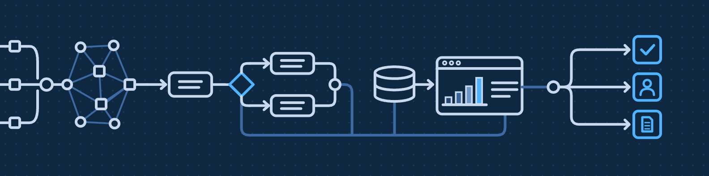
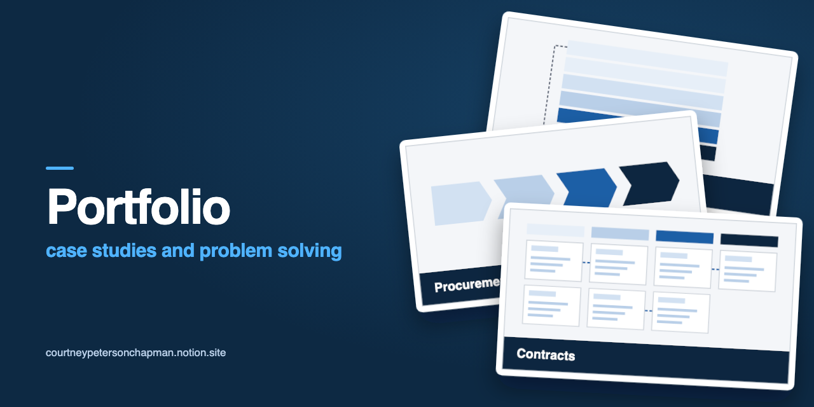

# Hi, I'm Courtney

I design and build solutions to complex business, financial, and operational problems. My work bridges business strategy, enterprise systems, analytics, automation, and AI-assisted development, turning fragmented information, processes, and requirements into practical tools and decision-support systems.

## Explore my work

- [Solutions for Government Contractors](https://courtney-chapman.github.io/tools-public/) — apps and AI tools for procurement, government property, and contracts.
- [Portfolio](https://courtneypetersonchapman.notion.site/) — case studies and problem solving.
- [Demonstrations](https://github.com/courtney-chapman/portfolio-public) — governed AI workflow demonstrations, design decisions, and related projects.

## What I build

- **Enterprise solutions:** Business systems and integrated workflows that connect processes, data, technology, and operational controls.
- **AI-assisted tools:** Research, analysis, decision support, and structured documentation.
- **Analytics & automation:** Dashboards, financial models, reporting, data transformation, and process automation.
- **Business applications:** Lightweight, purpose-built applications and interactive tools for focused tasks.

## Technical capabilities

- **Solutions architecture and systems design:** Business systems architecture · Requirements engineering · Data modeling · Systems integration · Solution prototyping
- **Analytics and business intelligence:** Power BI · Power Query · SQL/PLSQL · Oracle Analytics · Cognos · Microsoft Access · Financial modeling · Dashboard development
- **AI and intelligent automation:** OpenAI · Anthropic Claude · Google Gemini · AI-assisted development · Agentic workflows · Prompt engineering
- **Development and automation:** HTML · CSS · JavaScript · VBA/macros · Power Automate · Workato
- **Enterprise systems and platforms:** SAP Ariba · Deltek Costpoint · JAGGAER · Unanet · Salesforce · ServiceNow · Documentum · Jira · Confluence

## Domain experience

Enterprise finance and project controls; procurement, contracts, and supply chain; government property and regulatory compliance; business development and transformation—primarily in federal government contracting and complex enterprise environments.

## More links

- [How I Work](https://raw.githubusercontent.com/courtney-chapman/portfolio-public/main/01-projects/How%20I%20Work.pdf) — a slide deck on how I diagnose problems and design solutions.
- [LinkedIn](https://www.linkedin.com/in/courtney-peterson-chapman/) — professional experience and background.
